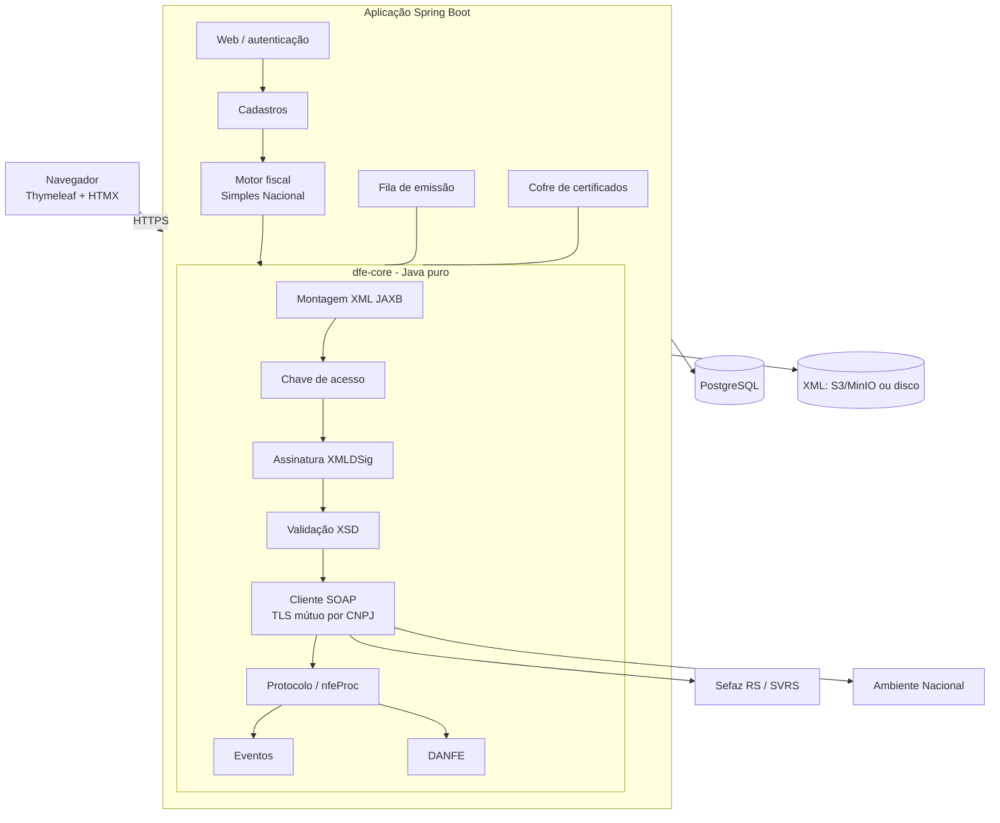

# Sistema NF-e: plano completo

Emissor próprio de **NF-e (modelo 55)** e **NFC-e (modelo 65)** para a **Sefaz RS**, feito do zero em Java,
multiempresa, com interface web. Começa em **homologação**.

> [!abstract] Resumo
> - **Linguagem:** Java 21 (Maven multi-módulo, monólito modular)
> - **Emitentes:** várias empresas, todas do **Simples Nacional**
> - **Interface:** sistema web (Thymeleaf + HTMX)
> - **Volume no 1º ano:** até 20 empresas
> - **Prazo estimado:** 4 a 5 meses (1 dev Java experiente)
> - **Repositório:** [Matheus2703/sistema_nfe](https://github.com/Matheus2703/sistema_nfe), branch `fase-0-fundacao`

---

## Situação atual

> [!warning] Fase 0: falta só o marco final
> Todo o código da fase 0 está pronto e testado (29 testes passando). Falta receber o
> **cStat 107** ("Serviço em Operação") da homologação real da Sefaz RS, rodando no notebook
> com o certificado da empresa.

### Histórico do teste real (no notebook, Windows)

| # | Tentativa | Resultado | O que foi feito |
|---|---|---|---|
| 1 | Rodar `dfe-cli.jar` | "Unable to access jarfile" | O `.jar` é gerado na compilação; adicionado o Maven Wrapper (`mvnw.cmd`) |
| 2 | 1º certificado | Lido certo, mas **vencido** (06/01/2026) | Adicionado aviso de certificado vencido |
| 2 | Conexão TLS | Java não confiava no servidor da Sefaz | Criado o comando `truststore` (cadeia ICP-Brasil) |
| 3 | Truststore | ✅ 186 certificados ICP-Brasil gravados em `icpbrasil.p12` | — |
| 3 | 2º certificado | ✅ válido até 16/09/2027 | — |
| 3 | Status | Conexão aberta, mas a Sefaz respondeu **HTTP 403** | TLS 1.2 fixo, cadeia completada, motivo do 403 exibido |
| 4 | Status com a correção | ⏳ **aguardando novo teste** | — |

> [!info] Hipótese para o HTTP 403
> O servidor IIS da Sefaz pede o certificado do cliente **depois** do handshake. Em TLS 1.3 o Java
> não atende esse pedido e o servidor responde 403 (403.7, "certificado do cliente obrigatório").
> A correção usa **só TLS 1.2**. Se ainda vier 403, a mensagem agora mostra o motivo exato
> devolvido pelo servidor (ex.: cadeia incompleta, empresa sem acesso à homologação).

### Próximo passo

- [ ] Baixar a versão nova da branch `fase-0-fundacao` e compilar com `.\mvnw.cmd -q package -DskipTests`
- [ ] Rodar `status` com o certificado válido e conferir **cStat 107**
- [ ] Com o 107 confirmado: iniciar a **Fase 1** (primeira NF-e autorizada)

---

## Arquitetura



### Módulos

| Módulo | Situação | Responsabilidade |
|---|---|---|
| `dfe-core` | ✅ criado | Schemas JAXB, certificado A1, TLS mútuo, SOAP, validação XSD, serviços Sefaz |
| `dfe-cli` | ✅ criado | Linha de comando para testes (`certificado`, `truststore`, `status`) |
| `dfe-danfe` | fase 3 | PDF do DANFE (A4) e DANFE NFC-e (80 mm) |
| `fiscal` | fase 5 | Motor de cálculo do Simples Nacional |
| `app` | fase 4 | Web, autenticação, multiempresa, cadastros, fila, painel |

### O que já existe no `dfe-core`

| Pacote | Classes |
|---|---|
| `comum` | `Ambiente`, `UF`, `ModeloDocumento` |
| `certificado` | `CertificadoA1` (CNPJ pelo OID ICP-Brasil 2.16.76.1.3.3, validade), `TruststoreIcpBrasil` |
| `xml` | `Xml` (sem prefixos de namespace, leitura protegida contra XXE), `ValidadorXsd` |
| `ws` | `CatalogoWebServices`, `ContextoTls`, `EnvelopeSoap`, `ClienteSefaz`, `ServicoSefaz` |
| `servico` | `ConsultaStatusServico`, `RetornoStatusServico` |
| gerado | `br.inf.portalfiscal.nfe.*` a partir dos XSD **PL_010h** (já com IBS/CBS) |

---

## Fases

| Fase | Entrega | Marco | Estimativa | Status |
|---|---|---|---|---|
| **0. Fundação** | Maven, XSD → JAXB, certificado, TLS mútuo, SOAP | `NfeStatusServico4` responde **107** | 1 semana | 🟡 falta o 107 real |
| **1. Núcleo NF-e** | XML mínimo (CSOSN 102), chave de acesso, assinatura, autorização síncrona, `nfeProc`, consulta protocolo | **Primeira NF-e autorizada (100)** | 2–3 semanas | ⚪ |
| **2. Eventos** | Cancelamento (110111), CC-e (110110), inutilização | Cancelar e corrigir nota de teste | 1 semana | ⚪ |
| **3. DANFE** | PDF A4 conforme MOC, e-mail com XML + PDF | DANFE aprovado pelo contador | 1–2 semanas | ⚪ |
| **4. Multiempresa e web** | Empresas, usuários, cofre de certificados, produtos, clientes, naturezas, séries, painel | Duas empresas emitindo isoladas | 2–3 semanas | ⚪ |
| **5. Motor fiscal Simples** | CSOSN 101/102/103/201/202/500/900, ST, DIFAL, IBS/CBS | Casos validados pelo contador | 2 semanas | ⚪ |
| **6. NFC-e** | CSC, QR Code, DANFE 80 mm, contingência offline | Primeira NFC-e autorizada | 2 semanas | ⚪ |
| **7. Robustez** | Fila, novas tentativas, contingência SVC, alertas, monitoramento | Queda simulada sem perder nota | 1 semana | ⚪ |
| **8. Notas recebidas** | `NFeDistribuicaoDFe` + manifestação do destinatário | Download automático por CNPJ | 1–2 semanas | ⚪ |
| **9. Produção** | Credenciamento, segurança, backup 5 anos, LGPD, `tpAmb=1` | Primeira nota real | 1–2 semanas | ⚪ |

### Fase 0: checklist

- [x] Projeto Maven multi-módulo (Java 21) + Maven Wrapper
- [x] Classes Java geradas dos XSD oficiais (PL_010h, com IBS/CBS)
- [x] Leitura do certificado A1: titular, CNPJ, emissor, validade, aviso de vencido
- [x] TLS mútuo com um certificado por empresa (TLS 1.2)
- [x] Truststore ICP-Brasil gerada pelo programa (`truststore --zip ACcompactado.zip`)
- [x] Cadeia do certificado completada com as ACs da truststore
- [x] Envelope SOAP 1.2, leitura do retorno e do SOAP Fault
- [x] XML sem prefixos (`ns2:`) e validação XSD antes de enviar
- [x] Endereços do RS (NF-e e NFC-e, homologação e produção) conferidos com o Portal Nacional
- [x] Consulta de status + teste com "Sefaz falsa" local exigindo certificado do cliente
- [x] Testes: 29 passando
- [ ] **cStat 107 na homologação real da Sefaz RS**

### Fase 1: checklist (próxima)

- [ ] Gerar `chave de acesso` (44 dígitos, dígito verificador módulo 11)
- [ ] Montar `<NFe>` mínima: emitente, destinatário, 1 item, CSOSN 102, pagamento, totais
- [ ] Assinar `infNFe` (XMLDSig enveloped, C14N, RSA-SHA1, `Reference URI="#NFe{chave}"`)
- [ ] Validar contra `enviNFe_v4.00.xsd`
- [ ] Enviar em `NFeAutorizacao4` síncrono (`indSinc=1`)
- [ ] Montar `nfeProc` (NFe + protNFe) e guardar
- [ ] `NFeConsultaProtocolo4` para recuperar nota após timeout ou rejeição 204
- [ ] Regras de homologação aplicadas automaticamente
- [ ] Marco: **cStat 100, Autorizado o uso da NF-e**

---

## Decisões técnicas que evitam rejeição

> [!tip] Regras que o código já segue ou vai seguir
> - XML no namespace padrão, **sem prefixos** (`ns2:`) nem declarações sobrando
> - Assinatura só sobre `infNFe`, `Reference URI="#NFe{chave}"`, enveloped + C14N, RSA-SHA1; `Id` registrado como ID
> - Truststore com a cadeia ICP-Brasil (não vem no Java)
> - **TLS 1.2**: o IIS da Sefaz pede o certificado do cliente depois do handshake
> - Um `SSLContext` por empresa, em cache, recriado na troca do certificado
> - Numeração com trava no banco por (empresa, modelo, série); número nunca reaproveitado; buracos viram inutilização
> - **Timeout nunca reenvia com número novo**: consulta pela chave; rejeição 204 (duplicidade) recupera o protocolo
> - Estados: `RASCUNHO → VALIDADA → ASSINADA → ENVIADA → AUTORIZADA | REJEITADA | DENEGADA → CANCELADA`
> - Todo XML enviado e recebido é guardado (auditoria)
> - Certificados criptografados em repouso (envelope encryption); senha nunca em log nem como argumento

### Regras de homologação

> [!note]
> - `tpAmb=2`
> - Na NF-e, nome do destinatário: `NF-E EMITIDA EM AMBIENTE DE HOMOLOGACAO - SEM VALOR FISCAL`
> - CNPJ do emitente igual ao do certificado
> - Inscrição estadual ativa no RS

### Web services da Sefaz RS (versão 4.00)

| Serviço | Homologação (NF-e) |
|---|---|
| Status | `https://nfe-homologacao.sefazrs.rs.gov.br/ws/NfeStatusServico/NfeStatusServico4.asmx` |
| Autorização | `https://nfe-homologacao.sefazrs.rs.gov.br/ws/NfeAutorizacao/NFeAutorizacao4.asmx` |
| Ret. autorização | `https://nfe-homologacao.sefazrs.rs.gov.br/ws/NfeRetAutorizacao/NFeRetAutorizacao4.asmx` |
| Consulta protocolo | `https://nfe-homologacao.sefazrs.rs.gov.br/ws/NfeConsulta/NfeConsulta4.asmx` |
| Inutilização | `https://nfe-homologacao.sefazrs.rs.gov.br/ws/nfeinutilizacao/nfeinutilizacao4.asmx` |
| Eventos | `https://nfe-homologacao.sefazrs.rs.gov.br/ws/recepcaoevento/recepcaoevento4.asmx` |

Produção: mesmo caminho em `nfe.sefazrs.rs.gov.br`. NFC-e: `nfce-homologacao.sefazrs.rs.gov.br` / `nfce.sefazrs.rs.gov.br`.
Lista completa em `dfe-core/src/main/resources/sefaz/webservices.properties`.

---

## Como rodar (Windows / PowerShell)

> [!example] Compilar
> ```powershell
> cd $HOME\Downloads\sistema_nfe-fase-0-fundacao
> .\mvnw.cmd -q package -DskipTests
> ```

> [!example] Gerar a truststore ICP-Brasil (uma vez)
> Baixar o `ACcompactado.zip` no site do ITI ("Certificados das ACs da ICP-Brasil – arquivo único compactado").
> ```powershell
> java -jar dfe-cli\target\dfe-cli.jar truststore --zip "$HOME\Downloads\ACcompactado.zip"
> ```

> [!example] Consultar o status da Sefaz RS
> ```powershell
> java -jar dfe-cli\target\dfe-cli.jar status --pfx "C:\caminho\certificado.pfx"
> ```
> Opções: `--modelo nfce`, `--ambiente producao`, `--tls 1.2|1.3|auto`, `--verbose`, `--truststore arquivo.p12`.
> A senha é pedida no terminal ou lida da variável `NFE_PFX_SENHA`.

> [!example] Rodar os testes
> ```powershell
> .\mvnw.cmd verify
> ```

---

## Riscos

| Risco | Mitigação |
|---|---|
| Assinatura rejeitada (canonicalização ou namespace) | Resolver na fase 1 com testes de XML de referência |
| Mudança de Nota Técnica (reforma IBS/CBS) | Classes geradas dos XSD; acompanhar Portal Nacional e Portal DF-e SVRS |
| Regra fiscal errada | Contador valida os casos da fase 5 antes da produção |
| Vazamento de certificado | Cofre criptografado, senha separada, logs sem segredos, `.pfx` no `.gitignore` |
| Duplicidade ou buraco na numeração | Trava no banco, consulta por chave, inutilização |
| Certificado vencido | Aviso no CLI; na fase 7, alerta 30 dias antes |

---

## Decisões tomadas

| Decisão | Escolha | Motivo |
|---|---|---|
| Linguagem | Java 21 | Domínio do time; XMLDSig, PKCS12 e TLS nativos no JDK ([ADR-001](ADR-001-linguagem-e-arquitetura.md)) |
| Biblioteca fiscal | Nenhuma ("do zero") | Controle total; custo: acompanhar MOC e NTs |
| Ordem | NF-e primeiro, NFC-e na fase 6 | Reduz o risco inicial |
| Tela | Thymeleaf + HTMX | Simples para um dev; sem SPA |
| Regime | Simples Nacional | Todos os emitentes iniciais |
| Build | Maven + Maven Wrapper | Não exige Maven instalado |
| TLS | 1.2 fixo (configurável) | Exigência prática dos servidores da Sefaz |
| Schemas | PL_010h (espelho do sped-nfe) | Conferir com o pacote oficial antes da produção |

## Em aberto

- [ ] Hospedagem: nuvem, VPS ou servidor próprio (o sistema roda em Docker em qualquer uma)
- [ ] Contador para validar o motor fiscal e o DANFE
- [ ] Conferir os schemas PL_010h com o pacote oficial do Portal Nacional da NF-e
- [ ] Pull request da `fase-0-fundacao` para `main` depois do 107

---

## Referências

- [Portal Nacional da NF-e](https://www.nfe.fazenda.gov.br/portal/principal.aspx): MOC, Notas Técnicas, schemas, web services
- [Portal DF-e SVRS](https://dfe-portal.svrs.rs.gov.br/)
- [Repositório ITI (cadeia ICP-Brasil)](https://www.gov.br/iti/pt-br/assuntos/repositorio)
- [Repositório do projeto](https://github.com/Matheus2703/sistema_nfe)
- NT 2026.007: NF-e sem IE para contribuinte exclusivo de IBS/CBS (autorização só pela SVRS)
